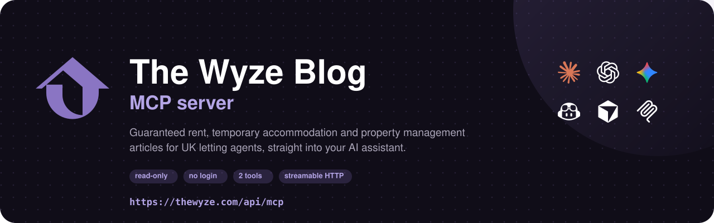
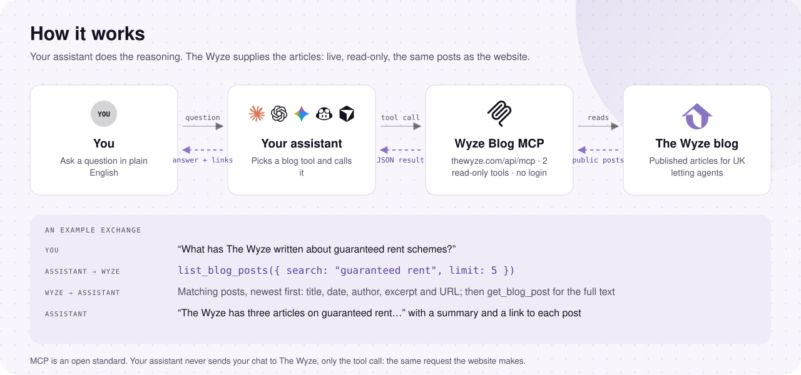
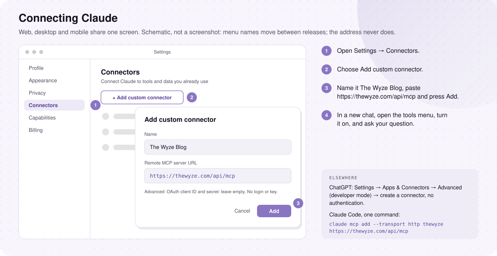
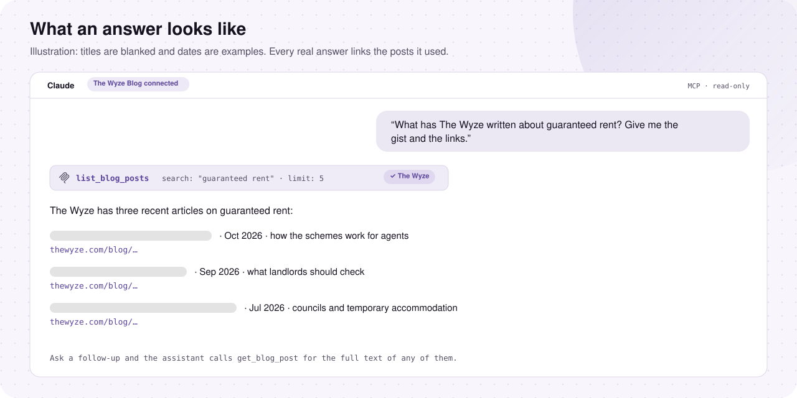
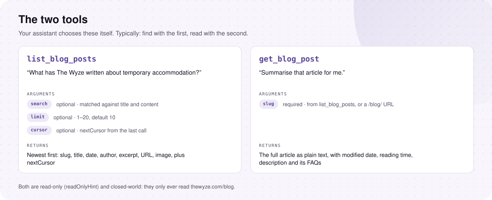
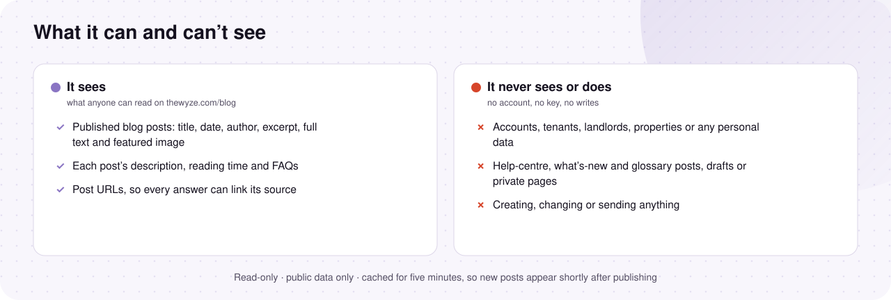

<div align="center">

<picture>
  <source media="(prefers-color-scheme: dark)" srcset="assets/banner-dark.svg">
  <source media="(prefers-color-scheme: light)" srcset="assets/banner-light.svg">
  
</picture>

<br/>

[](https://registry.modelcontextprotocol.io/)
[](#the-tools)
[](#what-it-can-and-cant-see)
[](LICENSE)

</div>

## What is this?

[The Wyze](https://thewyze.com) is property management software for UK landlords and letting agents, and
[its blog](https://thewyze.com/blog) covers guaranteed rent, temporary accommodation and running a lettings business.

This MCP server lets AI assistants like Claude, ChatGPT and Gemini search and read that blog directly, so answers
come from the actual articles, with links, rather than from guesswork.

It's hosted, so there's nothing to install or run.

## How it works

<picture>
  <source media="(prefers-color-scheme: dark)" srcset="assets/how-it-works-dark.svg">
  <source media="(prefers-color-scheme: light)" srcset="assets/how-it-works-light.svg">
  
</picture>

You ask your assistant a question. It calls one of the two blog tools over the open
[Model Context Protocol](https://modelcontextprotocol.io) and answers from what comes back, linking each post it used.
Your chat never goes to The Wyze, only the tool call does: the same request the website makes.

## Getting started

Add this URL to your AI assistant:

```
https://thewyze.com/api/mcp
```

That's it. No account, no API key.

### Claude (web, desktop and mobile)

<picture>
  <source media="(prefers-color-scheme: dark)" srcset="assets/connect-claude-dark.svg">
  <source media="(prefers-color-scheme: light)" srcset="assets/connect-claude-light.svg">
  
</picture>

1. Open **Settings → Connectors** and choose **Add custom connector**.
2. Name it **The Wyze Blog** and paste the URL above. Leave the OAuth fields empty: no login is needed.
3. In a new chat, open the tools menu, turn The Wyze Blog on, and ask your question.

### Claude Code

```bash
claude mcp add --transport http thewyze https://thewyze.com/api/mcp
```

### Cursor

<a href="https://cursor.com/install-mcp?name=thewyze&config=eyJ1cmwiOiJodHRwczovL3RoZXd5emUuY29tL2FwaS9tY3AifQ=="><picture>
  <source media="(prefers-color-scheme: dark)" srcset="https://cursor.com/deeplink/mcp-install-dark.svg">
  
</picture></a>

One click: it opens Cursor and adds a server named **thewyze** with the URL above. Or paste the config below.

### Gemini CLI

```bash
gemini extensions install https://github.com/The-Wyze/MCP
```

### ChatGPT

1. Open **Settings → Apps & Connectors**. Custom servers sit under **Advanced settings** (developer mode).
2. Create a connector named **The Wyze Blog**, paste the URL above, and choose **No authentication**.
3. Add it to a chat from the **+** menu and ask your question.

<details>
<summary><b>VS Code and GitHub Copilot, Windsurf, config files, and everything else</b></summary>

<br/>

**VS Code / GitHub Copilot**: add `.vscode/mcp.json` to your project (or run *MCP: Add Server*), start the server
from the file, then pick it in Copilot Chat's tools list in agent mode:

```json
{
  "servers": {
    "thewyze": { "type": "http", "url": "https://thewyze.com/api/mcp" }
  }
}
```

**Cursor** by hand (`~/.cursor/mcp.json`):

```json
{
  "mcpServers": {
    "thewyze": { "url": "https://thewyze.com/api/mcp" }
  }
}
```

**Windsurf** (`~/.codeium/windsurf/mcp_config.json`):

```json
{
  "mcpServers": {
    "thewyze": { "serverUrl": "https://thewyze.com/api/mcp" }
  }
}
```

**Gemini CLI** by hand (`~/.gemini/settings.json`, then restart; `/mcp` lists the tools):

```json
{
  "mcpServers": {
    "thewyze": { "httpUrl": "https://thewyze.com/api/mcp" }
  }
}
```

**Anything else that speaks MCP:** streamable HTTP at the URL above (POST, one JSON-RPC message per request, JSON
responses, no sessions). A plain GET on the same URL describes the server; the registry card is at
[`/.well-known/mcp/server.json`](https://thewyze.com/.well-known/mcp/server.json), with a copy in
[`server.json`](server.json).

</details>

### Check it's working

Ask: *"What are the latest posts on The Wyze blog?"*

Your assistant should call `list_blog_posts` and answer with titles, dates and links. If it answers from memory
instead, the server isn't switched on in that chat yet (see [Troubleshooting](#troubleshooting)).

## What an answer looks like

<picture>
  <source media="(prefers-color-scheme: dark)" srcset="assets/example-answer-dark.svg">
  <source media="(prefers-color-scheme: light)" srcset="assets/example-answer-light.svg">
  
</picture>

Every answer can link the post it came from, so you can read the original yourself.

## Things you can ask

- *"What has The Wyze written about guaranteed rent schemes?"*
- *"Summarise The Wyze's latest article and give me the link."*
- *"Find posts on temporary accommodation for councils."*
- *"What does The Wyze blog say about property management software for letting agents?"*
- *"List everything published this year, oldest last."*

## The tools

<picture>
  <source media="(prefers-color-scheme: dark)" srcset="assets/pick-a-tool-dark.svg">
  <source media="(prefers-color-scheme: light)" srcset="assets/pick-a-tool-light.svg">
  
</picture>

There are two, and they only read:

| Tool | Arguments | What it returns |
|---|---|---|
| `list_blog_posts` | `search` (optional), `limit` 1–20 (default 10), `cursor` (optional) | Posts newest first: slug, title, date, author, excerpt, URL and featured image, plus `nextCursor` for the next page |
| `get_blog_post` | `slug` (required; a `/blog/` URL works too) | One post in full as plain text, with its modified date, author, reading time, description and FAQs |

Both carry `readOnlyHint` and return structured JSON alongside the text.

## What it can and can't see

<picture>
  <source media="(prefers-color-scheme: dark)" srcset="assets/what-it-sees-dark.svg">
  <source media="(prefers-color-scheme: light)" srcset="assets/what-it-sees-light.svg">
  
</picture>

- It only sees blog posts already published on thewyze.com/blog. No accounts, tenants, landlords, properties or
  personal data, ever.
- Help-centre, what's-new and glossary posts aren't served, exactly as the website's `/blog` pages don't show them.
- It can't create, change or send anything.
- Results are cached for five minutes, so a new post shows up shortly after it's published.

## Troubleshooting

| What you see | What it means |
|---|---|
| The assistant answers without using the blog | The server isn't switched on in that chat. In Claude, open the tools menu and turn it on; in Cursor and Gemini CLI, restart after adding it. |
| `No blog post with that slug.` | The slug is wrong, or the post isn't a blog post. Ask the assistant to search with `list_blog_posts` first. |
| `The blog is temporarily unavailable` | The blog's backend didn't answer. Try again in a minute. |
| `405` / *This server offers no SSE stream* | The client opened an old-style SSE connection. Choose *HTTP* or *streamable HTTP* when adding the server. |
| `404 Not Found` | The address must be exactly `https://thewyze.com/api/mcp`. Agency portal domains don't serve it. |

## Found a problem?

If it's a security issue, please email **info@thewyze.com** rather than opening a public issue: see
[SECURITY.md](SECURITY.md). For anything else, issues are very welcome.

## Source code

The code behind the public server is in [`src/`](src), so you can see exactly what each tool does and returns. It
runs inside The Wyze's Next.js app and uses the app's WordPress helpers, so it won't run on its own from this repo;
it's here to be read and checked.

| Where | What |
|---|---|
| [`src/app/api/mcp/route.ts`](src/app/api/mcp/route.ts) | The endpoint: JSON-RPC handling, the two tools and what they return |
| [`src/lib/mcp/serverInfo.ts`](src/lib/mcp/serverInfo.ts) | The server's name, version and registry card |
| [`src/app/.well-known/mcp/server.json/route.ts`](src/app/.well-known/mcp/server.json/route.ts) | Serves the registry card |

The diagrams in this README are SVG files in [`assets/`](assets), drawn by
[`scripts/make-docs-images.py`](scripts/make-docs-images.py) so they can be redrawn when the tools change. The
assistant marks are their owners', used only to name the products that connect.

Releasing a new version, and how it reaches the MCP Registry, is in [RELEASING.md](RELEASING.md).

## Licence

The files in this repo are [MIT](LICENSE). The blog content the server returns isn't: it's The Wyze's, and the
name and logo are ours, so please don't use them as your own.

<br/>

<div align="center">

<sub>Made in the UK by <a href="https://thewyze.com">The Wyze</a> · Wise Systems Limited · <a href="CHANGELOG.md">Changelog</a></sub>

</div>
